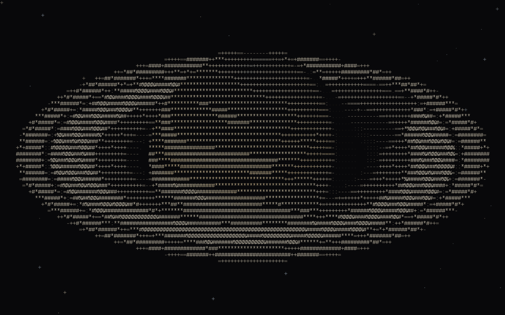

# saturn-art

A live, realistic **Saturn** spinning in your terminal — in colored ASCII art.

Every character is a ray traced through a 3D model of the planet, its
atmosphere and its rings, shaded in linear light and then quantized to a
character ramp. No sprites, no pre-baked frames: it renders in real time.



## Install

Requires Rust and a terminal with 24-bit color (`TERM=xterm-256color` is fine).

```sh
cd saturn-art
make install          # builds release and installs to ~/.local/bin
saturn-art
```

or, without make:

```sh
cargo build --release
install -Dm755 target/release/saturn-art ~/.local/bin/saturn-art
```

## Run

```sh
saturn-art
```

It uses the whole terminal. Bigger terminals show more detail; 80×24 works,
140×50 is lovely, 240×70 is show-off territory.

| key       | action             |
|-----------|--------------------|
| `q`/`Esc` | quit               |
| `space`   | pause              |
| `+`/`-`   | speed up / slow down |
| `s`       | toggle star field  |
| `h`       | hide hint line     |
| `r`       | reset time/speed   |

Options:

```
--fps N          frame rate, 5..120     (30)
--speed X        time multiplier        (1.0)
--tilt DEG       ring opening angle     (26, like Saturn's real maximum)
--no-stars       no star field
```

Snapshot mode (handy for wallpapers or checking a Terminal theme):

```sh
saturn-art --snapshot saturn.ppm --cols 240 --rows 70 --time 6
saturn-art --snapshot - --ascii --cols 100 --rows 40   # plain text frame
saturn-art --snapshot - > saturn.ppm                    # PPM on stdout
```

## What is actually being rendered

* **Camera** — orthographic, tilted ~26° above the ring plane, framing the
  full 2.27-planet-radii ring system.
* **Planet** — one ray/sphere intersection per sample. The texture is
  looked up in latitude/longitude, with a 27-stop color palette sampled from
  Saturn's real appearance: cream equatorial zone, butterscotch belts,
  olive-gray temperate bands and a pale blue-gray north polar hood. On top
  of that live fine ribbons, convective swirls, meandering jet edges, storm
  ovals (including a Great White Spot) and dark barges, all of which rotate
  with the planet.
* **Lighting** — a directional sun, Lambert shading with a softened
  terminator, limb darkening and a thin atmospheric rim, all in linear RGB
  and converted to sRGB for the terminal.
* **Rings** — a ray/plane hit against a radial density profile with the
  D, C, B and A rings, the Cassini Division, the Encke Gap and extra
  ringlets. Opacity is composited (you can see the planet through the C
  ring), and the ring sheet is lit by the sun.
* **Shadows** — the planet casts a real umbra on the rings (and on the far
  side of the ring sheet), and the rings cast a curved shadow band across
  the planet.
* **ASCII** — each cell is 2×2 supersampled, composited, converted to sRGB
  and mapped by luminance onto `" .:-=+*#%@"`, with 24-bit color per cell.
  A hash-based star field twinkles faintly behind everything.

## Tweaking

All the knobs are cheap to change:

* `src/scene.rs` — `BANDS_HEX` (planet palette), `RINGS_HEX` (ring bands),
  `SPIN` texture terms, `ring_sample`, and the shading constants.
* `src/main.rs` — `SPIN_RATE` (default: one rotation per ~46 s),
  `BASE_TILT_DEG`, `SUN` (direction of the sun).

## Tests

```sh
cargo test --release
```

Covers render sizing, the ring density profile (B ring dense, Cassini empty),
ray/sphere hits, shadow geometry and the glyph ramp.

## Notes

Saturn's rings are 2.27 planet radii wide but only tens of meters thick; in
this render they are a zero-thickness sheet, which is why the ansae get thin.
The planet's rotation direction, ring opening angle and the sun's position
are all configurable above.

Rendered with Rust, `crossterm`, and far too much trigonometry.
