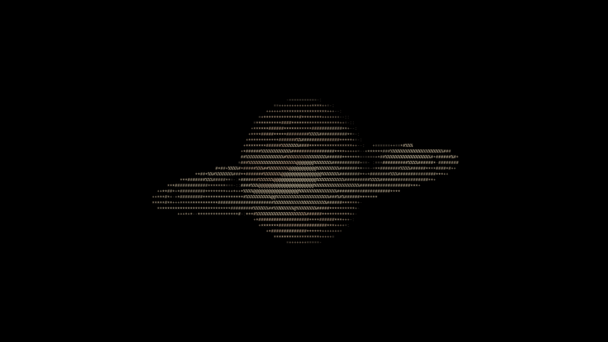

# saturn-art

A Rust CLI to render ray-traced Saturn



## Why this exists

A terminal can do more than print tables. This tool ray-traces Saturn into
coloured text, cell by cell, at a frame rate that still leaves the machine
usable. It is a demonstration of how far character cells and 24-bit colour can
go.

## How it works

The camera is a real perspective camera on an angled orbit. Each run starts at a
random pose and eases into a new nearby pose every few seconds, so the shot
never repeats. Framing comes from the ring system at its widest opening, so the
picture fits the terminal at every pose. Each character cell casts four to nine
rays, depending on terminal size, and composites what they hit, which keeps the
rings from flickering and dropping out at the ansae.

The planet is one ray and sphere intersection. Its surface is looked up in
latitude and longitude against a 27-stop palette sampled from real Saturn
images, with fine ribbons, convective swirls, jet edges, storms, and barges
layered on top. Shading runs in linear RGB with a directional sun, soft
terminator, limb darkening, an atmospheric rim, cool ringshine, and a warm glow
where the rings face the equator.

The rings are a ray and plane hit against a radial density profile with the D,
C, B, and A rings, the Cassini Division, the Encke Gap, and ringlets. Opacity
is composited, so the planet shows through the C ring. Shadows are geometric:
the planet casts an umbra across the ring sheet, and the sheet casts a curved
shadow band on the globe. Ring material orbits at Keplerian rates, faster inside
than outside, with a large-scale brightness asymmetry and two dark spokes.

The result is converted to sRGB and mapped by luminance onto a glyph ramp, with
24-bit colour per cell. There is no permanent overlay. A key press reports
itself briefly on the last row and fades, so the scene keeps the whole terminal.

## Usage

```text
saturn-art [OPTIONS] [COMMAND]

Commands:
  screensaver on       Install saturn-art as the Omarchy idle screensaver
  screensaver off      Restore the stock Omarchy screensaver
  screensaver status   Show what is active
  screensaver start    Show it now, any input dismisses
  screensaver delay    Set when it appears
  screensaver timeout  Set when the lock screen takes over

Options:
  --view NAME      edge, classic, dramatic, or closeup (edge)
  --charset NAME   Glyph ramp: classic, detailed, soft, blocks,
                   dense, dots, minimal, or mixed (classic)
  --fps N          Animation frame rate, 5 to 120 (30, 10 as screensaver)
  --speed X        Time multiplier (1.0)
  --tilt DEG       Camera elevation, -85 to 85 degrees (15)
  --azimuth DEG    Camera angle around the planet (10)
  --roll DEG       Camera roll around its axis (12)
  --dist R         Camera distance in planet radii (6.5)
  --zoom X         Framing zoom, 0.5 to 3.0 (1.0)
  --screensaver    Any key or click quits
  --snapshot PATH  Render a single frame and exit
  --cols N         Frame width for --snapshot (160)
  --rows N         Frame height for --snapshot (50)
  --time SECS      Scene time for --snapshot (0)
  --ascii          With --snapshot -, print plain text
  --color WHEN     Color: auto, always, or never (auto)
  -h, --help       Print help
  -V, --version    Print version
```

```bash
saturn-art
saturn-art --view classic
saturn-art --view closeup --speed 1.5
saturn-art --tilt 2 --roll 18
saturn-art --snapshot saturn.ppm --cols 240 --rows 70 --time 6
saturn-art --snapshot - --ascii --cols 100 --rows 40
```

## Notes

Keys: `q` or `Esc` quits, `space` pauses, `+` and `-` change speed, `c` cycles
the glyph ramp, and `r` resets time and speed. `--snapshot -` writes a PPM to
stdout unless `--ascii` is used. The screensaver commands manage Omarchy's idle
settings in `~/.config/omarchy/shell.json`. With the lock disabled, Saturn stays
on screen after waking from suspend until you press a key or click.

## Config

Optional. Reads `~/.config/saturn-art/config.toml` if present. Flags override the file; defaults apply otherwise.

```toml
view = "edge"
charset = "classic"
fps = 30
speed = 1.0
tilt = 15.0
azimuth = 10.0
roll = 12.0
distance = 6.5
zoom = 1.0
color = "auto"
```

## Install

**Requirements:** Rust 1.88+, `git`, and a terminal with 24-bit colour. The
screensaver commands require Omarchy.

```bash
cargo install --git https://github.com/batusaribay/saturn-art.git --locked
```

## License

This project is licensed under the [MIT License](LICENSE).
